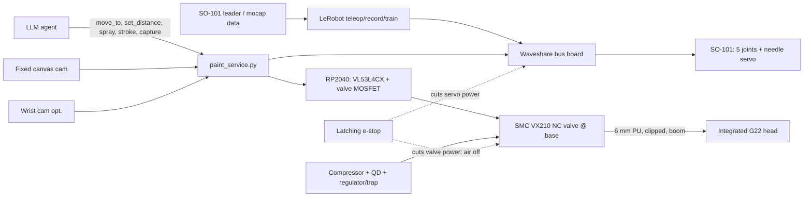

# Airbrush Painting Arm — Build Plan v3 (integrated head + Quest capture)

## What it is
An SO-101 follower arm (LeRobot) whose wrist/gripper stage is replaced by a **built-in airbrush head**: a stripped
Master Airbrush G22 (NEO-style clone) nozzle/needle/body in a printed wrist housing. The gripper STS3215 drives the needle (paint flow). A base-mounted
NC 12V solenoid switches air through 6 mm PU tubing, a ToF sensor holds standoff, and cameras give the agent visual feedback.
Stage 2 records a real airbrush artist and teaches the arm.

## v1 scope
Small desktop test unit: SO-101, about A3 / 12×16 in panel lying flat on the table or slightly tilted. Air: a **small compressor** with its regulator + moisture trap at **15–25 PSI** for the 0.3 mm G22 head.

## Arm + DOF (unchanged)
SO-101 = 5 joints + gripper. A flat canvas needs X/Y/standoff + pitch/yaw. Roll around the nozzle axis barely changes a round cone,
so **5-DOF is enough**, and the gripper servo becomes the needle servo. True 6-DOF open arms (PAROL6, Thor) cost far more
and aren't LeRobot-native.

## Integrated head — options and pick
| Option | Weight | Price | Verdict |
|---|---|---|---|
| (a) Commercial automatic: Sagola Mini V AeroJet "automatic airbrush" | 216 g | check | Needs pneumatic pilot air + its own valving; too heavy for the SO-101 wrist |
| (a) Anest Iwata RG-3 automatic side-feed gun | not published (heavier, 130 ml cup) | $467.25 list ($299.95 reseller) | Too heavy, too pricey, 0.6 mm only |
| (a) H&S Hansa 281 / Grafo T1/T3 / Colani "automatic" | n/a | ~6.7k–11k UAH | "Automatic" here means fixed-air dual action (pull back = paint + air), NOT robot-actuated. Still handheld |
| **(b) Stripped NEO-style clone head in printed wrist housing: Master Airbrush G22 0.3 mm** | NEO CN reference 77 g bare; G22 weight not published (weigh it), est. ~60–80 g stripped + housing ~30 g | **$29.99 each, buy 2** (1 head + 1 spare/parts) | **PICK** (NEO CN $100 stays the upgrade) |
| (c) Open-source effectors: IAAC airbrush end-effector (servo + fishing line pull-back, linear press), Third Hand spraycan actuator (NEMA23) | — | free | Reuse the IAAC needle-pull idea; Third Hand is too heavy |

**Why (b):** it removes the handle, trigger, separate trigger servo and hose fitting weight from the wrist. The 220 g solenoid lives at the
**base**, not the wrist. Wrist load is about 60–70 g head + 30 g housing + ToF/cam 15 g + 3–5 g tubing, roughly 110–120 g plus the existing
gripper servo, versus about 200 g + braided hose before. That's about half, which largely fixes the payload worry (still verify in Stage 0).

**Head design:**
- Keep the G22 body, nozzle, needle, needle chucking guide and spring. Remove the handle and main lever.
- Lock the built-in air valve open (printed plug/spacer pressing the valve stem) so the **base solenoid alone switches air**.
  Volume between solenoid and nozzle → small lag/hiss after closing; keep the run short and use 4 mm OD on the last section if needed.
- Needle retraction: the gripper STS3215 horn → printed cam/lever on the needle chucking nut (the same motion as a finger pulling back).
  The spring returns it. Servo position = flow. Target ≥ 3 mm needle travel (verify on donor).
- Sequence: air on → needle back → stroke → needle home → air off (avoid spitting).

## Air line
Compressor (tank) → 1/4 QD → regulator + moisture trap (compressor's own, or SMC AW20-F01E-B) → SMC TU0604 6×4 PU tube → **SMC VX210
NC 12V valve at arm base** (KQ2H06-01AS fittings) → 6 mm (or 4 mm) PU along the arm in printed clips with service loops at each joint
→ KQ2L06 elbow / 1/8 BSP adapter → head inlet. Overhead spring boom carries tubing + USB + servo cable from above. 15–25 psi to start (G22 rated 15–50 psi).
Verify thread types (R vs G vs NPT) at order.

## System diagram

## Sensing and cameras (unchanged picks)
- VL53L4CX ToF beside the nozzle, parallel, in a recessed shroud with a film window; spare unit. Ultrasonic is poor under 3 cm.
  OAK-D Lite (min 6.5 cm, $269) is a later option.
- A fixed 1080p UVC webcam on the canvas (homography via corner AprilTags). Optional mini wrist cam behind a shield.

## Software
LeRobot (`so101_follower`/`so101_leader`) for calibration, teleop, record and train. `paint_service.py` (FastAPI/MCP) exposes:
move_to(x,y,standoff), set_distance, spray(on, flow), stroke(path, speed), capture, status, stop, using IK on the SO-101 URDF
(repo/SO-ARM100/Simulation). Limits:
- workspace box
- speed cap
- spray only with ToF 3–25 cm and the pose in the box
- 500 ms watchdog → needle home + valve closed
- maximum spray time

## Stage 2 — teaching by motion capture (Meta Quest 3)
Recorded per timestep: tool tip 6D pose (canvas frame), standoff, air/cap press, paint pull-back (0–1), plus video.

**Getting data off the Quest (simplest first):**
1. **WebXR page in the Quest browser (PICK).** No app install. The page reads both controllers' pose + trigger/grip/buttons at the headset frame rate
   (72–120 Hz) and streams JSON over WSS to a Python server on the PC/box (needs HTTPS: a self-signed cert or the tool's built-in one).
   Start from **SpesRobotics/teleop** (WebXR, has a LeRobot teleoperator plugin `lerobot-teleoperator-teleop`) or **kabilankb/SO-101-VR-Control**
   (Quest 2/Pro/3/3S → SO-101 via PyBullet IK + LeRobot SOFollower with velocity/joint limits). Add a "record" mode that just logs poses + sleeve data.
   The same page then doubles as live VR teleop of the arm.
2. oculus_reader APK (used by Agilex questVR_ws): Android app + Python reader over USB/Wi-Fi ADB. Also good, but needs a sideloaded APK.
3. Quest2ROS2 (Unity app → ROS-TCP): pose/inputs/twist topics. Use it only if we go ROS 2.
4. OpenXR via Quest Link/Air Link or ALVR → SteamVR → PC (OpenVR/pyopenxr): high rate, but needs a Windows/GPU PC. Unity/Godot custom app: most work.
Quest 2/Pro: all of these work (SO-101-VR-Control lists Quest 2/Pro/3/3S). Quest 2 has slightly worse controller tracking (no ring-less Touch Plus) and a lower refresh rate.
Quest Pro controllers track themselves with onboard cameras, so they don't need to stay in headset view. That's best for capture if available.

**Mounting:** printed sleeve clamps the tool, holding the controller rigidly in a keyed cradle at a known offset (measure the tool-tip offset
with a pivot calibration: spin the tip on a fixed point and solve the offset).
- **Airbrush sleeve** (airbrush friends, later): controller on top/side of the brush; hall sensor on the air button + hall/pot on lever pull-back → RP2040 → BLE/USB.
  Or a simpler mapping: the artist uses the controller trigger as the lever proxy (trigger 0–1 → paint flow), but a real-brush sensor is truer.
- **Spray-can sleeve** (Risk Rock): can in a printed cage, controller on the side, FSR or microswitch + travel sensor under the cap
  (or the controller's own trigger mapped as "cap pressed" with a printed lever linking the cap to the trigger, so no electronics needed).
- Tracking limits: Quest 3 controllers are tracked by headset cameras + IMU, so if the artist turns away/reaches behind or the controller is
  occluded, pose degrades (IMU dead-reckoning for brief gaps). The artist wears the headset in passthrough or it's worn by an assistant watching;
  keep the controller in the headset's view. Quest 3 hand tracking is an option for "no hardware" capture, but it can't see trigger force and loses
  fingers when gripping a can. Use it only as a fallback.
- Time sync: log Quest timestamps + sleeve timestamps on the same server; a "tap" spike at session start aligns them.
- Canvas frame: touch the tool tip to 3–4 canvas corners at the start to register the Quest frame to the canvas.

**Risk Rock "graffiti can capture" session (first Stage 2 session):**
- Setup: large paper/cardboard wall (e.g. 2×1.2 m), Quest 3 on Risk Rock in passthrough (or on an assistant), spray-can sleeve with controller + cap sensor,
  a phone or webcam filming the wall, a ventilated outdoor/booth area, respirators.
- Record: corner registration → warm-up lines/fades → tags/letters/fills, 10–20 short takes. Note can, cap type and distance (15–30+ cm).
- **Scaling mural to arm (~A3):** uniform space scale (e.g. 2 m → 0.4 m = 0.2×), scale standoff by the same factor or map it to the airbrush's
  2–8 cm range (spray width ∝ distance, so it keeps line weight relative to size). Scale time so tip speed stays within servo limits while keeping
  the speed *profile* (accelerations, flick timing ratios) = style. Scale paint flow with speed to keep coverage per mm. Drop roll, clamp
  pitch/yaw, and convert fast wrist flicks into short tapered strokes.
- Output: replay on paper with the airbrush head (Stage 2a), then a LeRobot dataset → policy (Stage 2b).
- **Later option:** a spray-can end-effector (servo cap presser in a printed cage; ref Third Hand Spraycan-Actuator, which is NEMA23 on a UR10).
  A full 400 ml can (~400+ g) is far over SO-101 payload, so it needs small cans or a bigger arm. Park it for now.
- Airbrush-artist friends come later with the airbrush sleeve; same pipeline, no scaling needed (already arm-sized).

**Retarget + use:** canvas-frame tip pose → scale (above) → IK to 5 joints → needle/air from trigger values via calibration curve. Either
replay the trajectory directly or convert it to a LeRobot dataset (state = joints + ToF, images = cams, action = joint targets + needle + air) and train
ACT/diffusion on a rented GPU. The box has no GPU.

Other options considered: the SO-101 leader as a puppet (exact joint space, still useful for teleop and data clean-up); video-only pose (rough reference only);
VIVE Tracker 3.0 ($149 each + base stations, optional only).

## Buy vs print
Buy: BOM.csv. Print (X1C, PETG near paint): SO-101 STLs (repo/SO-ARM100/STL), wrist head housing, needle cam/lever, air-valve lock,
ToF/cam brackets, mist shields, tubing clips, boom clip, Stage 2 handheld sensor sleeve + tag cube.

## Tools
Hex/Phillips drivers, calipers, multimeter, crimps (12V/e-stop), PU tube cutter, PTFE tape, airbrush wrench + cleaning kit, USB cables.

## Stages
- **Stage 0, stock arm + LeRobot teleop:** build leader/follower, IDs, calibrate, teleop. Payload test: 120 g and 200 g at 60%/100% reach, log temp/current.
- **Stage 1, integrated head bench test with WATER:** strip the donor, fit it in the housing on a bench, plumb the valve + PU line, map needle angle → flow,
  check air lag. Prove the e-stop shuts air + servos. Then mount it on the arm and teleop with the leader trigger → needle.
- **Stage 2, Quest motion-capture teaching:** WebXR capture server + spray-can sleeve → Risk Rock session → scale/retarget → replay on paper (2a) → LeRobot dataset + policy (2b). Airbrush-friend sessions later with the airbrush sleeve.
- **Stage 3, sensors + cameras on the arm:** ToF standoff hold, canvas homography, arm-to-canvas registration (touch 4 corners, no paint).
  (Stages 2 and 3 overlap: Stage 2 replay needs the Stage 3 registration. Do the registration first in Stage 2 if replaying.)
- **Stage 4, agent control + painting:** paint_service + limits; air-only dry runs → thin paint on paper → canvas. Loop: capture → plan → stroke → compare.

## Paint environment
Sleeve the servos, keep electronics behind the base, compressor with regulator + trap + QD, flush the head after every session (it can't be
hand-wiggled like a handheld; add a "park and flush" pose over a cup), exhaust fan/booth, P100+OV respirator for humans.
CNC-cut base/easel fixture plate so registration holds.

## Safety
Latching e-stop → contactor removing servo bus power AND solenoid power. The NC valve means air off when unpowered. The needle spring returns
to closed on power loss. Speed cap ~20% at bring-up, nobody within reach when powered, torque off before touching.

## Gotchas
1. Payload: the lighter head helps, but verify; tubing stiffness at the wrist still adds torque, so use service loops + the boom.
2. Mist fouls ToF/cam windows; use shields and spares.
3. Arm is mm-level with backlash; fine lines need camera correction.
4. NEW: air volume between the base valve and nozzle gives on/off lag and a puff. Keep the run short / use 4 mm tube and sequence the needle.
5. NEW: stripping the G22 clone is fiddly (delicate 0.3 mm nozzle, needle packing), and cleaning an integrated head is harder. Buy spare head parts.
6. NEW: artist motion exceeds the arm (roll, flicks, speed). Retargeting slows it down and drops roll, so the output won't be 1:1.
7. Thread mismatch (BSP vs NPT vs R) between valve, fittings and airbrush adapter.

## Open questions
1. ANSWERED: small + large compressors owned; v1 uses the small one at 15–25 PSI. (Donor head: 2× Master G22, approved.)
2. ANSWERED: v1 = desktop test unit, ~A3 / 12×16 in panel flat or slightly tilted.
3. Paint type (water-based vs solvent) and where it runs (ventilation)?
4. Confirm the Quest model (3 assumed; Pro controllers are better for capture). Is Risk Rock OK wearing the headset, or will an assistant? Session location/date?
5. Fine detail (0.2–0.35 mm) or coverage (0.5 mm+) head?
6. 12V shoulder/elbow servos if the payload test still fails?

## For Clay (model after Caliper verifies)
Caliper first: G22 body Ø/length, nozzle-to-air-inlet distance, needle travel and chucking-nut Ø, air valve stem position and travel,
inlet thread (1/8 BSP?), cup clearance; SO-101 wrist/gripper-motor pattern (repo STEP); STS3215 45.2×24.7×35 mm (verify); VL53L4CX 25.4×17.8 mm (verify).
1. Wrist head housing replacing the gripper: clamps the G22 body, nozzle on the wrist axis, cup on top.
2. Needle cam/lever from the gripper servo horn to the chucking nut (≥ 3 mm travel, verify) + air-valve lock.
3. ToF bracket parallel to the nozzle with recessed shroud + film window; wrist cam bracket + shield.
4. Tubing clips for 6 mm / 4 mm PU along the links with service loops; boom clip; base valve bracket.
5. Stage 2: Quest 3 controller cradle (Caliper the controller) + spray-can sleeve with cap-to-trigger lever or FSR mount; later airbrush sleeve.
Nothing printed or ordered until the maintainers OK it.

7. Spray cans: which brand/cap does Risk Rock use (for the sleeve size)? A 400 ml can is ~66 mm Ø (verify).

## v2 bigger unit (later)
Larger reach: a stronger arm or a gantry (a CNC-style gantry is an option), the large compressor, and a possible spray-can end-effector for Risk Rock-scale work. Size it after v1 lessons (payload, accuracy, overspray, the scaling results).
